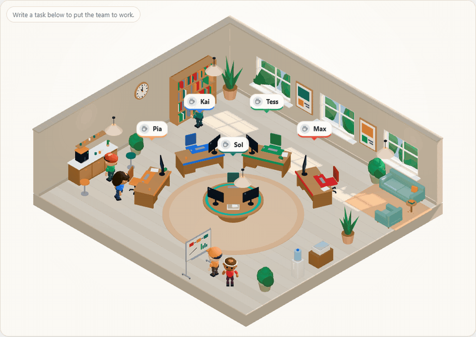
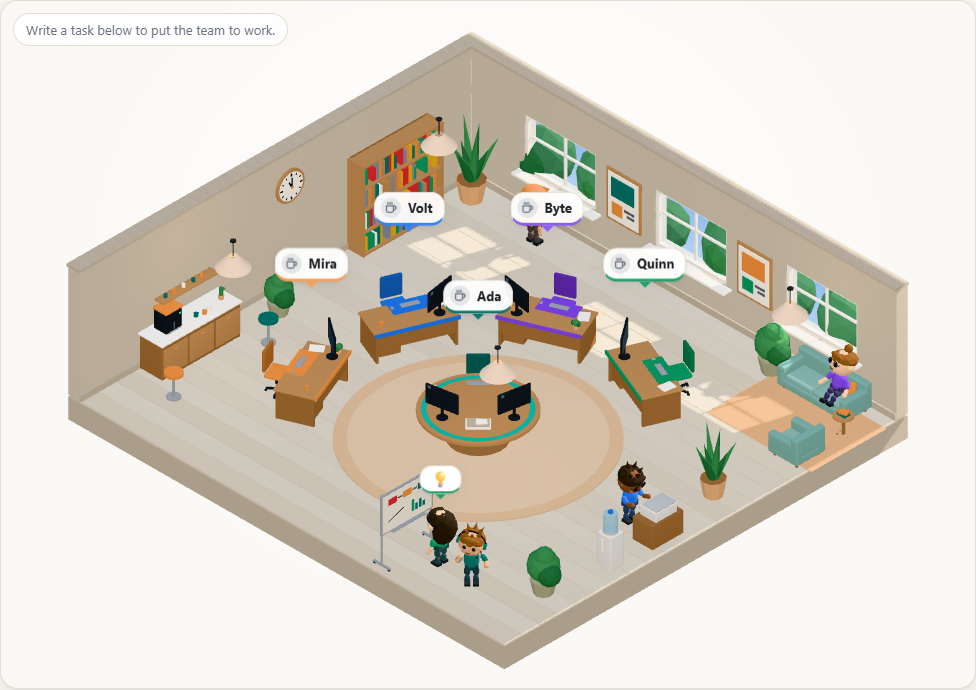
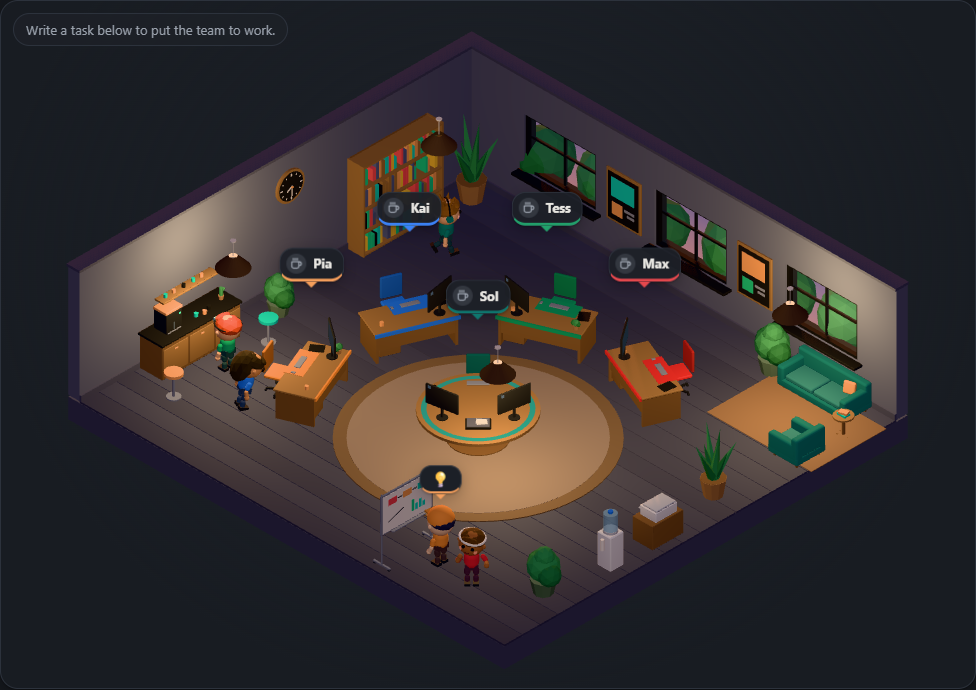
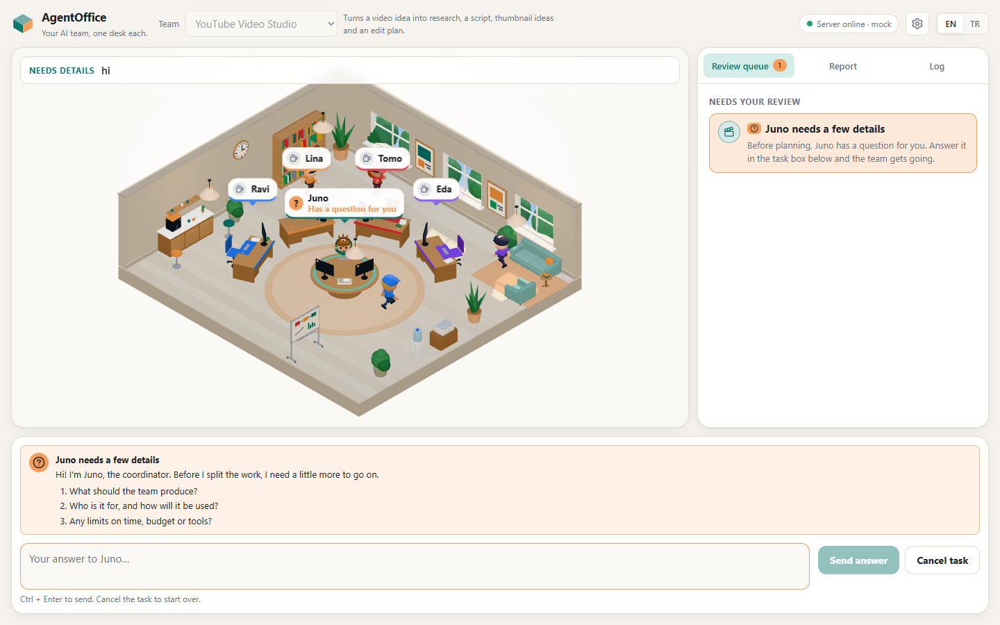
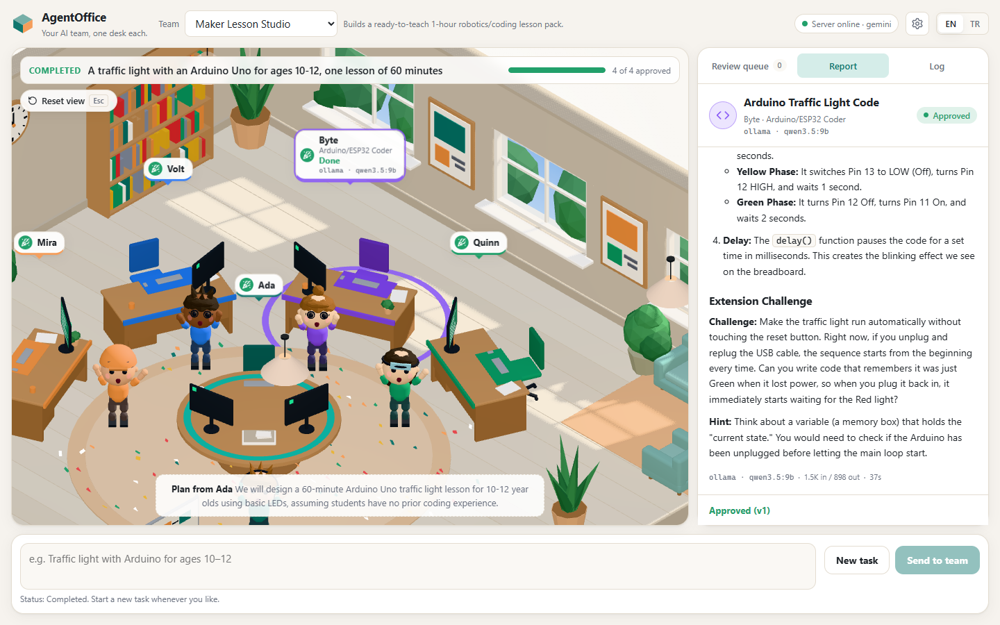
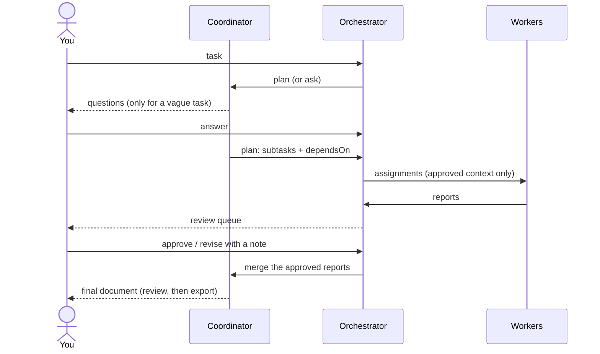
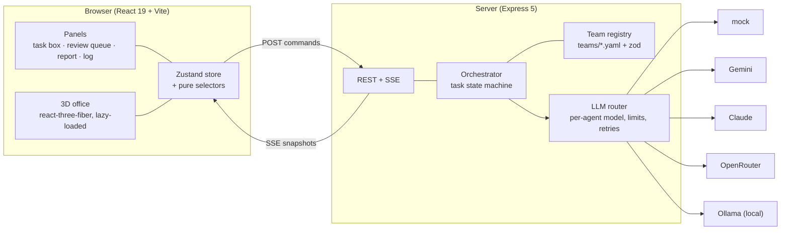

# AgentOffice

> Your AI team, one desk each.

[](https://github.com/BaranKaplan35/agent-office/actions/workflows/ci.yml)
[](LICENSE)



An isometric office where every desk is an AI agent. You type a task; the
coordinator splits it into subtasks and hands them out; the agents write their
reports; **you approve each one or send it back with a note**; and the coordinator
merges the approved work into one final document you can export.

The office is not decoration. It shows the system as it runs: envelopes fly from the
hub to the desks when work is assigned, characters sit down to type, raise a hand
when a report needs you, and celebrate when everything is approved.

- **Teams are data, not code.** A team is one YAML file in `teams/`. Three are
  included: Maker Lesson Studio, Software Startup and YouTube Video Studio.
- **You stay in charge.** Nothing moves on without your approval; revisions create
  new versions and approved work never changes.
- **It asks before it guesses.** A vague task (or just "hi") gets one to three
  questions from the coordinator first, not a made-up plan.
- **Any model, per agent.** Gemini, Claude, OpenRouter or a local Ollama model, mixed
  freely in one team. Every report shows which model wrote it, the tokens and the time.
- **Runs without anything.** The mock mode needs no key and no model, so the whole
  workflow can be tried right after `npm install`.

| Daytime                                               | Evening                                                               |
| ----------------------------------------------------- | --------------------------------------------------------------------- |
|   |  |
| **The coordinator asks first**                        | **Review a report**                                                   |
|  |         |

## Getting started

Requirements: Node.js 20.6+ (developed on Node 24).

### Quick try (mock)

```bash
npm install
npm run dev
```

Open http://localhost:5173. Nothing else to set up: without a `.env` (or with
`LLM_PROVIDER=mock`) every agent runs on the mock provider, including those that name
their own model in the team file. The answers are canned, but the whole workflow
works: questions, plans, reports, revisions, the final merge and the 3D office.

### With real models

1. Copy `.env.example` to `.env`.
2. Set `LLM_PROVIDER` to the coordinators' provider, e.g. `gemini`, and its key
   (`GEMINI_API_KEY`, free at https://aistudio.google.com/apikey).
3. The workers of the bundled teams run on a local [Ollama](https://ollama.com) model:
   install Ollama and run `ollama pull qwen3.5:9b`.
4. `npm run dev`. At startup the server lists every agent's model and names anything
   missing (key, Ollama not running, model not pulled).

Any agent can use another provider; see the table and the mixed-team example below.

### Production build

```bash
npm run build
npm start
```

One server on port 3001 (or `PORT`) serves the API and the built client.

## How it works

1. **Clarify (only if needed).** If the task isn't a task or is too vague to plan, the
   coordinator replies with one to three questions. Your answer continues the same
   task; after two rounds it plans with stated assumptions.
2. **Plan.** The coordinator splits the task into at most one subtask per worker and
   states who builds on whose work (`dependsOn`).
3. **Work.** Every subtask whose dependencies are approved starts. Workers only ever
   receive _approved_ versions of their teammates' reports.
4. **Review.** Each report lands in your review queue. Approve it, or send it back
   with a note; the revision becomes v2, v3 … and old versions stay readable.
5. **Merge.** When everything is approved, the coordinator merges it into one final
   document, which you review the same way and then copy or download as Markdown.



Agents never talk to each other directly: every message (assignment, report,
approval, revision request, question) is an `AgentMessage` that the orchestrator
routes, logs and streams to the browser. The 3D office and the panels are two views
of that same stream.

### Architecture



- **`shared/`** — the types both sides use: teams, tasks, messages, events.
- **`server/`** — the orchestrator (planning, scheduling along `dependsOn`, revisions,
  merge, cancel, timeouts), the team loader with hot reload, and `llm/`, the only place
  that talks to a model. API keys stay here.
- **`client/`** — panels that work on their own (also without WebGL, on low quality or
  with reduced motion) and the 3D office, which is built entirely in code from
  Three.js primitives: no model files, textures or fonts.

## Add a team in one file

Create `teams/<your-team>.yaml`. In development the server reloads it right away; no
code changes and no restart.

```yaml
id: podcast-studio # lowercase letters, digits and "-"
version: 1
name: { en: Podcast Studio, tr: Podcast Stüdyosu }
description:
  en: Turns a topic into a ready-to-record podcast episode.
  tr: Bir konuyu kayda hazır bir podcast bölümüne dönüştürür.
taskPlaceholder:
  en: 'e.g. A 20-minute episode on how habits form'
  tr: 'örn. Alışkanlıkların nasıl oluştuğu üzerine 20 dakikalık bölüm'
finalTitle: { en: Episode Pack, tr: Bölüm Paketi }

agents:
  - id: coordinator # exactly one coordinator
    type: coordinator
    name: { en: Ada, tr: Ada }
    role: { en: Host & Producer, tr: Sunucu ve Yapımcı }
    icon: mic # any lucide.dev icon name
    deskColor: '#0F766E'
    systemPrompt: |
      You are Ada, the host and producer of a small podcast. You split the
      topic into focused subtasks and merge the approved work into one episode pack.

  - id: research # 2–5 workers
    type: worker
    name: { en: Ravi, tr: Ravi }
    role: { en: Researcher, tr: Araştırmacı }
    icon: search
    deskColor: '#3B82F6'
    systemPrompt: |
      You are Ravi, a researcher. Produce the key facts, sources to check and
      three surprising angles for the episode.

  - id: script
    type: worker
    name: { en: Lina, tr: Lina }
    role: { en: Scriptwriter, tr: Senarist }
    icon: pen-line
    deskColor: '#F59E5B'
    dependsOn: [research] # gets Ravi's approved report as context
    systemPrompt: |
      You are Lina, a scriptwriter. Based on the approved research, write the
      episode outline with an intro hook, segments and an outro.
```

The server checks every file when it loads it and says exactly what is wrong (for
example `agents.2.dependsOn: "script" depends on unknown worker "reserch"`); a broken
file is skipped, the other teams keep working.

| Field                      | Required | What it does                                                                 |
| -------------------------- | -------- | ---------------------------------------------------------------------------- |
| `id`, `version`            | yes      | Team id (unique) and a version number                                        |
| `name`, `description`      | yes      | Shown in the team picker, in English (`en`) and Turkish (`tr`)               |
| `taskPlaceholder`          | yes      | Example task shown in the empty task box                                     |
| `finalTitle`               | yes      | Title of the merged final document                                           |
| `settings.maxRevisions`    | no       | Revisions allowed per report (default 3, 0–10)                               |
| `settings.maxOutputTokens` | no       | Output limit per report (default 2048); the final merge gets twice as much   |
| `agents[].type`            | yes      | `coordinator` (exactly one) or `worker` (2–5)                                |
| `agents[].name`, `role`    | yes      | The character's name and job title                                           |
| `agents[].icon`            | yes      | A [lucide](https://lucide.dev/icons) icon name                               |
| `agents[].deskColor`       | yes      | Hex colour of the desk and the character's outfit                            |
| `agents[].systemPrompt`    | yes      | Who the agent is and what it delivers; output rules are added automatically  |
| `agents[].dependsOn`       | no       | Workers whose approved reports this worker needs; cycles are rejected        |
| `agents[].llm`             | no       | `{ provider, model }` to run this agent on its own model                     |
| `agents[].personality`     | no       | `social`, `diligent`, `coffee`, `calm` or `curious`: free time in the office |
| `agents[].mockResponse`    | no       | Canned Markdown for mock mode (`{{task}}` is replaced with the task)         |

## Models and providers

Every agent runs on a model. By default all agents use `LLM_PROVIDER` from `.env`
with that provider's default model; any agent can pick its own in the team file
(ignored while `LLM_PROVIDER=mock`).

| Provider     | Set in `.env`                             | Default model      | Cost                                   | Where your prompts go               |
| ------------ | ----------------------------------------- | ------------------ | -------------------------------------- | ----------------------------------- |
| `mock`       | nothing                                   | —                  | free                                   | nowhere: canned answers, no model   |
| `gemini`     | `GEMINI_API_KEY` (`GEMINI_MODEL`)         | `gemini-3.6-flash` | free tier with daily limits, then paid | Google (Gemini API)                 |
| `anthropic`  | `ANTHROPIC_API_KEY` (`ANTHROPIC_MODEL`)   | `claude-haiku-5-5` | paid per token                         | Anthropic (Claude API)              |
| `ollama`     | `OLLAMA_BASE_URL` (`OLLAMA_MODEL`)        | `qwen3.5:9b`       | free, runs on your own computer        | stays on your machine               |
| `openrouter` | `OPENROUTER_API_KEY` (`OPENROUTER_MODEL`) | `openrouter/auto`  | some free models, otherwise per token  | OpenRouter and the model's provider |

- **Free tiers are small.** In November 2026 the Gemini free tier allowed only 20
  requests a day for `gemini-3.6-flash`. With the coordinator on Gemini and the
  workers on Ollama, a task makes two or three cloud calls (questions, plan, merge).
  When a quota is used up, the app says so and when it resets.
- **Ollama:** install it, then `ollama pull qwen3.5:9b` (or the model you name). Local
  models get one call at a time, a longer timeout and a 16K context window, so a worker
  that builds on its teammates' reports gets them in full (`OLLAMA_CONCURRENCY`,
  `OLLAMA_TIMEOUT_MS`, `OLLAMA_NUM_CTX`).
- **If planning fails** (quota, model down), the task bar shows why and offers "Try
  again"; the prompt and any answers to the coordinator's questions are kept.
- **At startup** the server checks every agent's model (keys present, Ollama running,
  model pulled) and names the team and agent that can't run. Those teams can be viewed
  but not started until it is fixed; the server rechecks every 30 s.
- **What you see:** each desk bubble shows its model on hover; every report shows the
  model, tokens and time it took (`ollama · qwen3.5:9b · 1.1K in / 1.5K out · 36s`);
  the final output adds the totals per model for the whole task.

### A mixed team

Add `llm` to any agent in `teams/*.yaml`; `model` is optional (the provider's default
from `.env` is used without it):

```yaml
agents:
  - id: coordinator
    type: coordinator
    llm: { provider: anthropic, model: claude-haiku-5-5 } # plans and merges
    # name, role, systemPrompt …
  - id: engineering
    type: worker
    llm: { provider: ollama, model: qwen3.5:9b } # code stays on your machine
  - id: marketing
    type: worker
    llm: { provider: openrouter } # OPENROUTER_MODEL
  - id: product # no llm: the .env default, e.g. Gemini
    type: worker
```

Each provider used needs its key in `.env`. API keys never leave the server; model
names are public and shown in the UI. All bundled teams are mixed teams: the
coordinator (questions, planning, the final merge) uses the `.env` default, for
example Gemini, and every worker runs on `ollama / qwen3.5:9b`.

## The office

- **Hub and spoke:** the coordinator sits at a round desk in the middle, the workers'
  desks form an arc around it.
- **Real time of day:** daylight follows your local clock and the lamps come on in
  the evening; `?hour=19.5` in the URL picks a time.
- **Office life:** between tasks the characters chat, fetch coffee, stretch, check the
  printer or the whiteboard, or sit in the lounge, each in line with its `personality`.
- **Settings** (the gear in the header): graphics quality Auto / High / Low and motion
  System / Full / Reduced. Reduced motion keeps everyone calmly at their desk, with
  fades instead of flights and an instant camera.
- **Always usable:** without WebGL, or if the scene fails, a flat board shows the same
  desks; every action is also in the panels.
- **Languages:** English and Turkish, for the interface and for what the agents write.

## Scripts

| Command                              | What it does                                            |
| ------------------------------------ | ------------------------------------------------------- |
| `npm run dev`                        | API server + Vite dev server with hot reload            |
| `npm test`                           | Run all tests (Vitest)                                  |
| `npm run lint` / `npm run typecheck` | Static checks                                           |
| `npm run format`                     | Format everything with Prettier                         |
| `npm run build`                      | Build client and server                                 |
| `npm start`                          | Run the production server (serves the built client too) |

CI runs the format check, lint, typecheck, tests and build on Node 22 and 24 for every
push and pull request.

### README media

The GIF and screenshots in `docs/media` are made by `scripts/capture/media.mjs`, which
drives a headless Chrome over the DevTools Protocol (Node built-ins only). For the GIF,
`?capture=1` puts the office in a deterministic capture mode: the scene no longer
follows the real clock but advances exactly 1/15 s per step, CSS animations included,
while a recorded mock task timeline is replayed frame by frame. ffmpeg turns the frames
into the GIF.

```bash
# a mock-mode production server on a spare port (leaves your .env untouched)
npm run build && PORT=3101 LLM_PROVIDER=mock node server/dist/index.js
node scripts/capture/media.mjs shots  http://localhost:3101
node scripts/capture/media.mjs record http://localhost:3101   # mock task timeline
node scripts/capture/media.mjs gif    http://localhost:3101   # needs ffmpeg
node scripts/capture/media.mjs report http://localhost:5173 <taskId> <agent name>
```

For a GIF that fits in 15 seconds, the recording server used shorter mock delays
(`MOCK_WALK_IN_MS=3500 MOCK_MIN_DELAY_MS=1000 MOCK_MAX_DELAY_MS=1800`).

## Tech

TypeScript everywhere · React 19, Vite, Zustand · Three.js with
`@react-three/fiber` and `@react-three/drei` · Express 5, Server-Sent Events, zod ·
`@google/genai`, `@anthropic-ai/sdk`, plain `fetch` for Ollama and OpenRouter ·
Vitest, ESLint, Prettier · npm workspaces.

## License

[MIT](LICENSE) © 2026 Baran Kaplan
